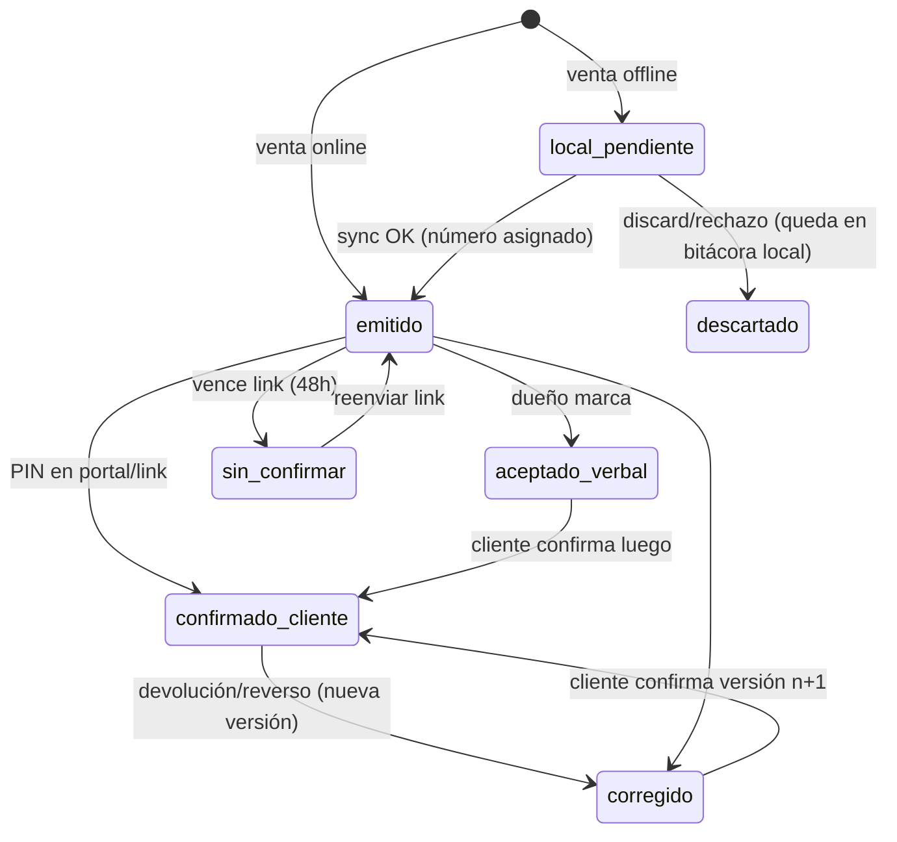

# D4 — Comprobante de acuerdo y confirmación de venta (propuesta, NO implementar)
Base: `teka369/dulcecalle@6f8f5ff1f3c1c9cae4f734dd09a304fb947fa54c` (clon `/workspace/deep-audit/pm/dulcecalle`). Autor: PM. Solo diseño.
Etiquetas: **[HECHO]** verificado en código · **[RIESGO]** · **[HIPÓTESIS]**.

## 0. Qué existe hoy (base real)
| Pieza | Evidencia | Nota |
|---|---|---|
| Venta con `paymentKind` paid/partial/credit, `saleTotal`, `amountReceived`, `credit`, `method?`, `note`, `requestId` | `backend/prisma/schema.prisma:26-30, 208-234` | Sin número legible (solo UUID), sin vencimiento, sin estado de confirmación |
| Reglas de pago: paid ⇒ recibido=total; credit ⇒ recibido=0; partial ⇒ 0<recibido<total | `backend/src/shared/sale-math.ts:6-41` [HECHO] | |
| Parcial/Fiada exige cliente; venta de contado puede ser sin cliente | `backend/src/sales/sales.service.ts:113-117` [HECHO] | Flujo D ya existe sin trazabilidad de comprador |
| Fiado suma a `customer.debt` | `sales.service.ts:296-299` | `debt` es saldo **almacenado**, no derivado |
| Abono (`CustomerPayment`) resta de `customer.debt` y crea `cash_move debt_collect`; rechaza si excede deuda | `backend/src/cash/cash.service.ts:337-430` | Abono es **a nivel cliente**, no a una venta: `saleId` existe (`schema.prisma:432`) pero el front lo envía `null` (`src/data/pwa/offline-payments.ts:81`) |
| Devolución: `refundAmount` + `debtReduced` vía `splitReturnSettlement` (primero fiado de esa venta, nunca bajo la deuda) | `schema.prisma:258-280`, `backend/src/shared/returns.ts:17-37`, `sales.service.ts:457-565` | Venta original intacta (API_CONTRACT.md:192) |
| Deuda inicial (`InitialDebt`) suma deuda, sin caja, salta candado de día | `schema.prisma:449-466`, `catalog.service.ts:670-718`, API_CONTRACT.md:199 | |
| No hay endpoint de anular/editar/borrar venta ni abono | `sales.controller.ts:14-52`, `cash.controller.ts:176` (solo POST/GET) | Bueno: ya es casi append-only. Único borrado: wipe de negocio `business-data.service.ts:155-159` |
| Día cerrado = sin mutaciones económicas | `backend/src/shared/day-guard.ts:23-56`, DOMAIN.md:219 | |
| Portal cliente: login código+PIN (bcrypt, throttle), token con `businessId`, access 15 min, ledger con ventas/líneas/devoluciones/abonos | `customer-access.service.ts:88-177, 271-342`, `schema.prisma:164` | Ledger público **omite la nota del abono** (`customer-access.service.ts:333-339`) |
| Offline: outbox Dexie con `requestId` = Idempotency-Key, estados pending/in_flight/synced/failed, `discard` borra efecto local | `src/data/local/outbox.ts:29, 112-245`, `outbox-cleanup.ts` | Un `discard` elimina la venta local que el cliente pudo ver → [RIESGO] para el comprobante |

**Brecha clave para el caso real (cliente dice que pagó):** no hay forma de que el cliente *confirme* nada, el abono no se liga a una venta y `customer.debt` es un contador que no se reconcilia contra Σ movimientos. El comprobante ataca la primera parte; la reconciliación es de D3/D6.

## 1. Flujos (según BRIEF: A, B, C, D)
| Flujo | Hoy (campos) | Propuesta | Fricción objetivo |
|---|---|---|---|
| **A Pago completo** (PAGADO) | `paid`, `amountReceived=saleTotal`, `credit=0` | Comprobante automático, **sin** pedir aceptación. Compartir es opcional (1 tap). | 0 taps extra |
| **B Pago parcial** | `partial`, `credit=total-recibido`, cliente obligatorio | Resumen previo + aceptación del cliente **recomendada** (§3). Abonos posteriores = nuevos `CustomerPayment`, nunca edición. | +1 paso (mostrar resumen) |
| **C Fiada** | `credit`, `amountReceived=0` | Igual que B + vencimiento **opcional** + condiciones en texto corto. | +1 paso |
| **D Venta sin cliente** | `customerId=null`, solo contado posible | Comprobante con número `DC-######`, sin aceptación. Trazable por número, hora, método, líneas. | 0 |
| Corrección/devolución (transversal) | `SaleReturn` | Nueva versión/evento ligado al comprobante; nunca se reescribe el original (§5). | — |

## 2. Resumen previo (lo ve el cliente antes de confirmar)
```
Tienda Doña Rosa · Venta #DC-000125 · 3 nov 2026 10:12 (hora Colombia)
Cliente: Pedro (código P-014)
2 × Chocoramo  $2.500  = $5.000
1 × Combo tinto $3.000 = $3.000
Total $8.000 · Pagado hoy $3.000 (Nequi) · Queda debiendo $5.000
Deuda anterior $12.000 → Deuda nueva $17.000
Acuerdo: paga el viernes 6 nov (opcional)
[ Cliente confirma ]   [ Confirmar después ]
```
- "Deuda anterior/nueva" sale de `customer.debt` antes/después; mostrarlo es lo que más evita la discusión "yo no debía tanto".
- Si está offline: banda "Sin señal · se enviará al sincronizar" (no prometer que el servidor ya lo tiene).
- Una casilla del dueño ("cliente de acuerdo") **no** es aceptación del cliente: se registra como `owner_attested`, distinto de `customer_confirmed`.

## 3. Mecanismos de aceptación del cliente
Escala 1 (malo) – 5 (bueno); en complejidad y costo, 5 = más simple/barato.
| Mecanismo | Complejidad | Costo | Privacidad | Seguridad | Facilidad (calle) | Valor probatorio | Comentario |
|---|---|---|---|---|---|---|---|
| Vendedor marca «aceptado verbalmente» | 5 | 5 | 5 | 1 | 5 | 1 | Solo la palabra del dueño; útil como registro operativo, no como aceptación |
| Confirmación en el **portal existente** (código+PIN) | 4 | 5 | 4 | 4 | 3 | 4 | Reusa `customer-access` y `pinHash`; requiere que el cliente tenga PIN y celular con datos |
| **Link/QR firmado** de un solo uso que abre el comprobante; confirmar pide el **PIN del portal** | 3 | 5 | 4 | 4 | 4 | 4 | QR en pantalla del vendedor o link por WhatsApp (compartir nativo, sin API paga) |
| Link firmado sin PIN (solo posesión del link) | 4 | 5 | 3 | 2 | 5 | 2 | Quien tenga el link confirma; débil si el link se reenvía |
| OTP por WhatsApp/SMS (API) | 2 | 2 (pago por mensaje, plantillas Meta/operador) | 3 (teléfono a tercero) | 4 | 3 | 4 | Requiere teléfono verificado (hoy `phone` es opcional, `schema.prisma:156`) |
| Firma en pantalla del vendedor | 3 | 5 | 4 | 2 | 4 | 2 | Garabato en el dispositivo del dueño; fácil de impugnar, se puede fabricar |
| Foto (cliente/papel) | 3 | 4 (almacenamiento) | 1 | 2 | 3 | 2 | Datos personales sensibles; no prueba conformidad con el monto |
| PIN de un solo uso tecleado por el cliente en el teléfono del vendedor | 3 | 5 | 4 | 3 | 4 | 3 | El cliente digita su PIN de portal en el dispositivo del dueño: riesgo de que el dueño lo vea |

**Recomendación:** MVP = **(1) registro verbal del dueño siempre disponible, etiquetado como tal** + **(2) link/QR firmado al comprobante, con confirmación por PIN del portal existente** cuando el cliente tenga PIN. Sin OTP pago ni firma ni foto en MVP. Motivo: costo cero, reusa auth/throttle ya endurecidos, funciona por WhatsApp sin integración, y separa claramente "dueño dice" de "cliente confirmó".

## 4. Evidencia operativa vs integridad técnica vs validez legal
| Capa | Qué es | Cómo se logra aquí |
|---|---|---|
| Evidencia operativa | Registro ordenado y fechado que sirve para conversar y resolver con el cliente | Comprobante + historial por cliente/deuda; quién, cuándo, cuánto, medio |
| Integridad técnica | Poder demostrar que el registro no cambió después | Versión inmutable + `contentHash` (SHA-256 del JSON canónico) + cadena `prevHash` por negocio; hora del servidor (`createdAt`) además de la del dispositivo |
| Validez legal | Si un juez/autoridad lo acepta como prueba de la obligación | **No se afirma.** La Ley 527 de 1999 (mensajes de datos, firma electrónica) — texto: http://www.secretariasenado.gov.co/senado/basedoc/ley_0527_1999.html — y el Decreto 2364 de 2012 (firma electrónica) son el marco a revisar. No verifiqué su aplicación a este caso; **esto no es asesoría legal**; Juan debería consultar a un abogado antes de comunicar valor jurídico. Copy en la app: "comprobante del acuerdo", nunca "documento con validez legal". |

## 5. Comprobante inmutable, historial y tipos de dinero
**Regla:** un comprobante emitido no se edita. Toda corrección es un evento nuevo (devolución, reverso, anulación) que genera **versión n+1** del comprobante apuntando a la anterior.

| Concepto | Significado | Campo real hoy | Falta |
|---|---|---|---|
| Recibido | Dinero que entró ese momento | `Sale.amountReceived` + `cash_move kind=sale`; `CustomerPayment.amount` + `cash_move debt_collect` | — |
| Prometido | Lo que el cliente se compromete a pagar | `Sale.credit` (fiado de esa venta); `InitialDebt.amount` | `dueDate`, texto de acuerdo |
| Registrado | Lo que el dueño anotó (con o sin confirmación) | Cualquier fila con `createdAt` | `confirmationState` |
| Aplicado | A qué deuda se imputó un abono | **No existe**: abono reduce `customer.debt` global; `CustomerPayment.saleId` siempre null (`offline-payments.ts:81`) | Asignación FIFO derivada (cálculo, no tabla) o `PaymentAllocation` (después) |
| Devuelto | Lo que se regresa | `SaleReturn.refundAmount` (dinero) + `debtReduced` (deuda condonada por devolución) | — |
| Afirmación del cliente | "Yo ya pagué" sin movimiento | No existe | `Dispute` (después; en MVP, nota) |

**Historial reconstruible por cliente:** orden por `createdAt` de `InitialDebt(+)`, `Sale.credit(+)`, `SaleReturn.debtReduced(−)`, `CustomerPayment.amount(−)`; saldo corrido = Σ. Ya hay datos para hacerlo (`catalog.service.ts:569-650`); falta mostrar el saldo corrido y **comparar contra `customer.debt`** (si difieren → alerta, ver D6).

**Correcciones por reverso:** hoy no hay anulación de venta ni de abono. Proponer `SaleVoid`/`PaymentReversal` (fila nueva, con motivo y referencia) que genera movimientos inversos de caja/stock/deuda; el original queda visible y tachado. Abono equivocado ⇒ reverso + abono nuevo, nunca edición.

**Protege a ambas partes:** el dueño no puede alterar un comprobante confirmado (inmutable + hash + el cliente tiene copia en el link/portal); el cliente no puede afirmar un pago sin `CustomerPayment`/`cash_move` correspondiente; quedan distinguidos afirmación, promesa, confirmación y pago recibido.

## 6. Modelo de datos preliminar
**Nuevo**
| Entidad | Campos |
|---|---|
| `Receipt` | id, businessId, number (`DC-000125`, secuencia por negocio asignada en servidor), saleId?, customerId?, kind (`sale`/`payment`/`return`/`reversal`/`initial_debt`), version, prevReceiptId?, snapshot JSON (líneas, total, pagado, pendiente, deuda antes/después, acuerdo), contentHash, prevHash, deviceCreatedAt, createdAt (servidor), confirmationState, requestId |
| `ReceiptConfirmation` | id, receiptId, version, method (`portal_pin`/`signed_link_pin`/`owner_verbal`), actor (`customer`/`owner`), at, ipHash?, userAgent?, linkTokenId? |
| `ReceiptLink` | id, receiptId, tokenHash, expiresAt, usedAt?, revokedAt? |
**Campos nuevos en existentes**: `Sale.dueDate?`, `Sale.agreementText?` (≤140 chars); `CustomerPayment.note` ya existe, exponerlo en portal.
**Después**: `PaymentAllocation`, `Dispute`, `SaleVoid`/`PaymentReversal`.
Número de venta: se asigna al sincronizar (offline se muestra provisional `DC-LOCAL-xxxx`). [Decisión Juan]

## 7. Estados y transiciones

**Reglas**: A y D nacen `emitido` sin pedir confirmación; B/C nacen `emitido` y piden confirmación (no bloquean la venta); confirmación es por versión; link de un uso, 48 h, revocable; un comprobante no confirmado sigue siendo válido operativamente, solo pierde valor probatorio.

## 8. Offline y recuperación
| Caso | Comportamiento |
|---|---|
| Sin señal al vender | Resumen y comprobante locales (`local_pendiente`), QR no disponible (el link necesita servidor); se ofrece "verbal" y "enviar link al sincronizar" |
| Cliente no confirma | Queda `sin_confirmar`; recordatorio al dueño en la ficha del cliente; reenviar link |
| Disputa "ya pagué" | Mostrar historial con saldo corrido + comprobantes y su estado; si no hay `CustomerPayment`, el dueño registra el abono o deja nota. `Dispute` formal: después |
| Venta descartada del outbox después de mostrarla | El comprobante local pasa a `descartado` y se conserva en bitácora local (hoy `cleanupOutboxLocalEffect` lo borra: [RIESGO]) |
| Reenvío / doble tap | Mismo `requestId` ⇒ mismo comprobante (idempotencia existente) |
| Pérdida de dispositivo | Lo sincronizado está en servidor; lo pendiente se pierde (D6) |

## 9. MVP vs después
**MVP (sin burocracia):** número `DC-` por negocio · resumen previo con deuda antes/después · `Receipt` inmutable con `contentHash` · link/QR firmado + confirmación con PIN del portal · marca "verbal" del dueño separada · historial con saldo corrido · nota del abono visible en portal · compartir por WhatsApp con `navigator.share`/`wa.me` (sin API).
**Después:** `dueDate`+recordatorios, `PaymentAllocation`, reversos/anulación, `Dispute`, cadena `prevHash`, OTP, PDF.
**No hacer:** firma en pantalla, foto del cliente, afirmar validez legal.

## 10. Decisiones para Juan
1. ¿Confirmación del cliente obligatoria en fiado/parcial, o solo sugerida? (PM: sugerida).
2. Formato y momento del número `DC-` (al sincronizar vs prefijo por dispositivo).
3. ¿Abonos aplicados FIFO a la deuda más vieja (derivado) o elegidos por venta?
4. ¿Se permite anular venta/abono (reverso) y quién (owner vs staff)?
5. Vigencia del link (48 h propuesto) y si el cliente sin PIN puede confirmar solo con link (PM: no).
6. Consulta legal antes de cualquier copy sobre valor jurídico.
