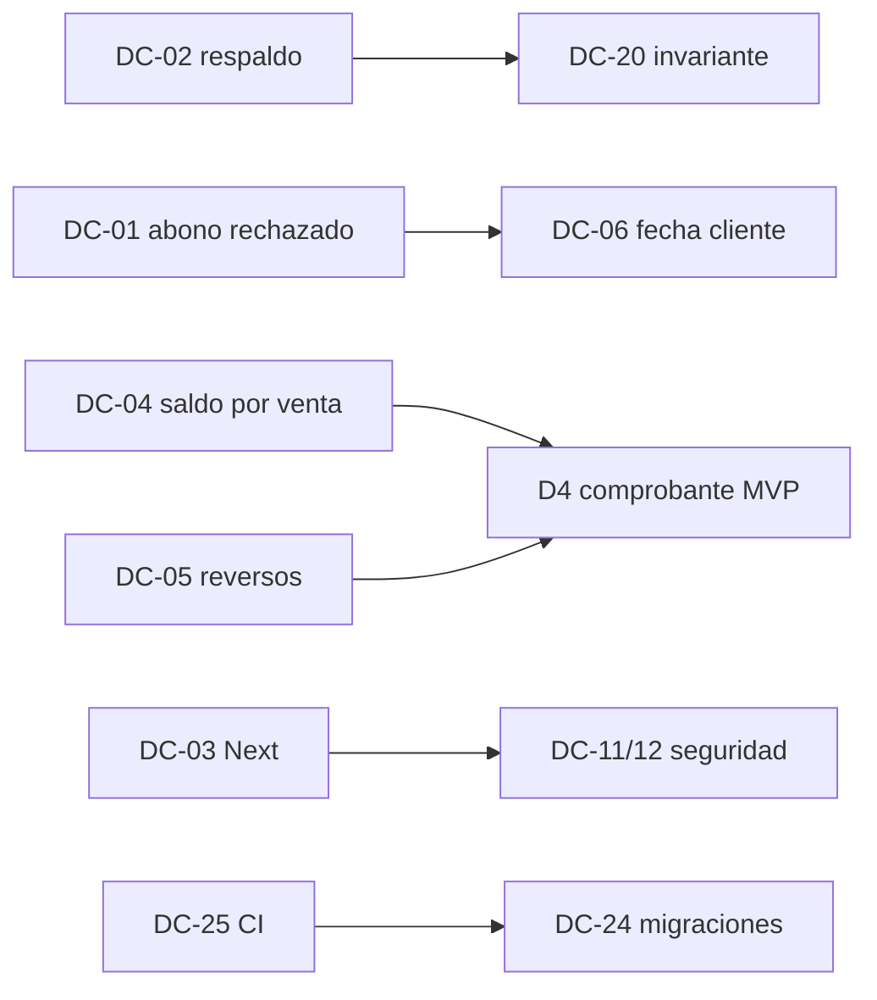

# D8 — Plan priorizado P0–P4
IDs DC- de D5. Orden dentro de cada nivel = orden sugerido de ejecución. Nada de esto se implementó en la auditoría.

## P0 — antes de seguir usando el sistema para fiados
| # | Qué | DC | Dependencias | Riesgos | Mitigación mientras tanto (sin código) |
|---|---|---|---|---|---|
| 1 | **Respaldo**: pg_dump diario fuera de Neon (retención 30 d) + snapshot manual antes de cada deploy con migración + export obligatorio antes de `DELETE /v1/business/data` | DC-02 | Secreto en GitHub Actions (decisión Juan) | Manejo de credencial | Snapshot manual Neon ya; no usar «Borrar datos» |
| 2 | **Next.js parcheado** (≥16.4.x según aviso) + @serwist/* | DC-03 | Rama + build + e2e offline (69 Playwright) | Romper SW/precache | — |
| 3 | **Abono rechazado nunca se revierte en silencio**: (a) no borrar cash move ni deuda ante rechazo permanente sin decisión del dueño, aviso bloqueante con cliente/monto; (b) cierre de caja sincroniza/avisa pendientes; (c) servidor acepta abono de día cerrado en caja pendiente | DC-01 (+DC-14 descarte con confirmación, DC-16) | (c) depende de política de día cerrado (decisión Juan) y DC-06 | Cambia reglas de cierre | Cerrar caja solo con todo sincronizado (pill «En el servidor») |

## P1 — integridad de deuda y claridad
| # | Qué | DC | Depende de |
|---|---|---|---|
| 4 | Saldo por venta (FIFO calculado) en portal y tienda | DC-04 | Decisión FIFO vs elegir venta |
| 5 | Verificación de invariante de deuda (SQL de D3 en solo lectura, luego CHECK + endpoint) | DC-20 | — (el SQL puede correrlo Juan ya) |
| 6 | `clientOccurredAt` | DC-06 | P0-3 |
| 7 | Reversos con motivo | DC-05 | Decisión de permisos |
| 8 | Carrera read-cache | DC-07 | Cambio de contrato |
| 9 | UX de dinero: confirmación visible, selector con código/deuda, Inicio con Cobrado | DC-08, DC-09, DC-10 | — |
| 10 | Seguridad: deps backend, tokens fuera de localStorage | DC-12, DC-11 | Rama de pruebas |
| 11 | Monitoreo/alertas | DC-23 | — |

## P2
DC-13 idempotencia con hash · DC-15 clamps · DC-17 saldo a favor · DC-18 cierre asumido · DC-19 importador · DC-21 staff/userId · DC-22 rotación refresh · DC-24 migraciones · DC-25 CI · DC-27 pendientes visibles/persist · DC-28 resumen previo (D4 MVP) · DC-29..DC-32 UX de caja/devolución. **Comprobante D4 MVP** entra aquí, después de DC-04/DC-05 (necesita saldo por venta y reversos).

## P3
DC-26, DC-33, DC-34, DC-35, DC-36, DC-40, DC-41, DC-42, DC-45, DC-46..DC-50, DC-53, DC-54.

## P4
DC-37, DC-38, DC-39, DC-43, DC-44, DC-51, DC-52.

## Dependencias clave

Regla: no tocar datos de producción para "corregir" saldos hasta tener P0-1 y el resultado del SQL de P1-5.
